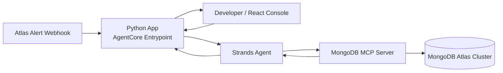

# Mongo Buddy

**A developer companion for MongoDB that turns MongoDB Atlas alerts into evidence-backed diagnostics.**

Mongo Buddy pairs a [Strands Agents](https://strandsagents.com/) agent with the official MongoDB MCP server. A React console renders the raw MCP responses (databases, slow-query explain plans, metrics, and root-cause evidence), so every conclusion can be traced to real data.

Built as a live demo for [AWS Community Day Mumbai](https://acd.awsugmum.in/).

---

## Problem Statement

Developers working with MongoDB often struggle to interpret Atlas alerts and system issues. A notice like “System Memory: Max Used above threshold” says that something went wrong, but not why it happened or what to do about it. Finding the cause means digging through metrics, slow-query logs and Performance Advisor, which takes time and deep database expertise. This slows down incident response and leaves teams reacting to alerts instead of fixing the underlying problem.

## Opportunity

Agentic AI can close this gap if it is grounded in real system state rather than generic advice. The Model Context Protocol (MCP) gives agents a standard, governed way to call tools against live infrastructure. The official MongoDB MCP server exposes database operations through that interface, so an agent can inspect actual deployments, run explain plans, and retrieve metrics instead of speculating.

## Solution

Mongo Buddy is organized into five layers:

| Layer | Component | Responsibility |
|---|---|---|
| **Reasoning** | Strands Agents SDK | Plans and sequences tool calls, then synthesizes results into findings |
| **Tool** | Official MongoDB MCP server | Discovers databases, runs slow-query explain plans, and pulls performance metrics from live clusters |
| **Experience** | React console | Displays the raw MCP responses so conclusions stay traceable and verifiable |
| **Runtime** | Amazon Bedrock AgentCore | Hosts the same Python app as a managed, scalable agent runtime |
| **Trigger** | Atlas alert webhook | Starts an investigation automatically when an alert fires |



## Key Design Principles

1. **Grounded in evidence:** Every recommendation is tied to real MCP output, not model assumptions.
2. **Standards-based:** MCP and open agent frameworks keep the stack modular and portable.
3. **Production-ready by design:** One codebase runs from a laptop to AgentCore, which shortens the path from demo to deployment.
4. **Human-in-the-loop transparency:** The console exposes the agent's inputs and outputs for review.

## Expected Outcomes

- Faster time from alert to root cause
- A lower expertise barrier for diagnosing query and index issues
- A reusable reference architecture for building production-grade AI agents on AWS with MongoDB

## Tech Stack

- **Agent framework:** [Strands Agents](https://strandsagents.com/)
- **Tooling protocol:** Model Context Protocol (MCP) with the official MongoDB MCP server
- **Runtime:** Python, Amazon Bedrock AgentCore
- **Frontend:** React
- **Data platform:** MongoDB Atlas

## Context

Mongo Buddy is a live demonstration for AWS Community Day Mumbai. It shows how agentic AI, MCP, and managed agent infrastructure combine into a practical, production-oriented developer workflow that goes beyond a conceptual demo.

# Mongo Buddy: Deployment Guide

1. [Install the tools](#1-install-the-tools)
2. [AWS account](#2-aws-account)
3. [Atlas service account](#3-atlas-service-account)
4. [Check the agent on the workstation](#4-check-the-agent-on-the-workstation)
5. [Give the runtime one stable outbound IP](#5-give-the-runtime-one-stable-outbound-ip)
6. [Deploy the agent](#6-deploy-the-agent)
7. [Point the console at that runtime](#7-point-the-console-at-that-runtime)
8. [Deploy the Atlas alert webhook](#8-deploy-the-atlas-alert-webhook)
9. [Confirm the whole path](#9-confirm-the-whole-path)

---

## 1. Install the tools

On macOS or Linux:

- Git
- [uv](https://docs.astral.sh/uv/) (it installs Python 3.14)
- Node.js 22, which supplies `npm` and `npx`
- AWS CLI v2
- AWS SAM CLI
- jq
- The AgentCore CLI. Confirm it with `agentcore --help`. The command you need is `agentcore deploy`.
- Docker, only if you want to build the image on the workstation. AgentCore builds the ARM64 image in CodeBuild during deploy.

```bash
git clone <your-repo-url> mongo-buddy
cd mongo-buddy
uv python install 3.14
uv sync
npm install --prefix frontend
```

## 2. AWS account

Use one IAM user in the account that will own the runtime.

| User | Required permissions |
| --- | --- |
| **Deploy user** | CloudFormation, CDK, ECR, CodeBuild, IAM, EC2, Lambda, S3, Bedrock, and Bedrock AgentCore |
| **Workstation user** (only opens the console) | `bedrock-agentcore:InvokeAgentRuntime` on the runtime and on `…/runtime-endpoint/*`, plus `s3:ListBucket`, `s3:GetObject`, and `s3:PutObject` on the alert bucket |

```bash
aws configure
aws sts get-caller-identity
export AWS_REGION=ap-south-1
export AWS_DEFAULT_REGION=ap-south-1
```

In the Bedrock console for `ap-south-1`, enable `in.anthropic.claude-opus-5`. If that inference profile is not available, set `MODEL_ID=apac.amazon.nova-pro-v1:0` in `.env` and in `mongobuddy/agentcore/agentcore.json`.

Bootstrap CDK once per account and region:

```bash
cd mongobuddy/agentcore/cdk
npm install
npx cdk bootstrap aws://ACCOUNT_ID/ap-south-1
cd ../../..
```

Put that account id in `mongobuddy/agentcore/aws-targets.json`. 

## 3. Atlas service account

In the Atlas project: **Organization Access Manager → Applications → Service Accounts**. Create a service account and give it read access to the project. This demo does not need permission to create indexes or change the cluster.

Add two addresses to that service account's API access list, each as a `/32`.

> [!WARNING]
> Do not add `0.0.0.0/0`.

- **The workstation's current public IP.** Atlas returns `403 IP_ADDRESS_NOT_ON_ACCESS_LIST` until this is listed. Get it with `curl -4 ifconfig.me`.
- **The NAT Elastic IP from [step 5](#5-give-the-runtime-one-stable-outbound-ip).** Add that after the network script prints it.

```bash
cp .env.example .env
```

Fill `MDB_MCP_API_CLIENT_ID` and `MDB_MCP_API_CLIENT_SECRET` in `.env`. Leave the MCP command as `npx -y mongodb-atlas-mcp-remote@latest`. Set the same two values in `mongobuddy/agentcore/agentcore.json` under `runtimes[0].envVars`.

> [!IMPORTANT]
> The copy of the secret already in that file should be replaced, not reused, and it should not be committed again.

## 4. Check the agent on the workstation

This proves Bedrock and Atlas before any deploy. The UI does not use this process.

```bash
uv run mongo-buddy
```

That listens on <http://127.0.0.1:8080>. `GET /ping` should succeed. Stop it when the check is done.

## 5. Give the runtime one stable outbound IP

Atlas must allow the runtime's address. Run this once per AWS account. It creates a VPC, a NAT Gateway, and an Elastic IP, and it writes those ids into `mongobuddy/agentcore/agentcore.json`.

> [!WARNING]
> A NAT Gateway is billed while it exists. The script is not safe to run twice.

```bash
bash mongobuddy/scripts/setup-agentcore-network.sh
```

Copy the printed Elastic IP and add `that-address/32` to the Atlas service account API access list.

> [!NOTE]
> If you are joining the existing account `979559056307`, skip this script. The VPC, subnet, and security group are already in `agentcore.json`. Ask for the NAT address that is already on the Atlas access list, and add only your workstation IP.

## 6. Deploy the agent

Deploy from `mongobuddy`, not from the repo root. The image is `mongobuddy/Dockerfile`: Python 3.14, Node, and `uv run mongo-buddy`.

> [!CAUTION]
> One deploy at a time. A second deploy fails while the first is using `agentcore/cdk/cdk.out`.

```bash
cd mongobuddy
agentcore validate
agentcore deploy --yes
agentcore status
```

Save the runtime ARN. It looks like `arn:aws:bedrock-agentcore:ap-south-1:ACCOUNT:runtime/mongobuddy_mongo_buddy-…`. The first cold start is slow because the container runs `npx` to start the MongoDB MCP server.

## 7. Point the console at that runtime

`frontend/agentcore-proxy.js` defaults to the existing runtime and to bucket `mongobuddy-atlas-alerts-979559056307`. For a new account, set these in the shell before starting the UI:

```bash
export AWS_REGION=ap-south-1
export AGENTCORE_RUNTIME_ARN='arn:aws:bedrock-agentcore:ap-south-1:ACCOUNT:runtime/RUNTIME_ID'
export ALERT_BUCKET='mongobuddy-atlas-alerts-ACCOUNT'
cd ..
chmod +x scripts/dev.sh
./scripts/dev.sh
```

Open <http://127.0.0.1:5173>. Ask it to list databases. The first reply can take about 20 seconds. The workstation's AWS user must be allowed to call `InvokeAgentRuntime` on both the runtime ARN and `RUNTIME_ARN/runtime-endpoint/*`.

## 8. Deploy the Atlas alert webhook

Still from the repo root:

```bash
cd webhook
sam build
sam deploy --guided \
  --parameter-overrides \
  "WebhookSecret=$(openssl rand -base64 32)" \
  "AgentRuntimeArn=arn:aws:bedrock-agentcore:ap-south-1:ACCOUNT:runtime/RUNTIME_ID"
```

Write down the secret and the `WebhookUrl` output. The stack creates:

- Lambda `mongodb-atlas-alert-webhook`
- A public function URL
- Private bucket `mongobuddy-atlas-alerts-ACCOUNT`, which the console polls

The Lambda role must be able to call `bedrock-agentcore:InvokeAgentRuntime` on the runtime ARN and on `…/runtime-endpoint/*`. The template already includes both. `alert.open` is investigated. Other alert events are acknowledged and stop.

In Atlas: **Project Settings → Integrations → Webhook Settings**. Paste the function URL and the same secret. On each alert that should wake Mongo Buddy, add **Webhook** as a notification.

> [!NOTE]
> There is no test-alert button. Cross a threshold on a non-production cluster.

## 9. Confirm the whole path

1. `aws sts get-caller-identity` shows the account you deployed to.
2. <http://127.0.0.1:5173> answers a database question from the cluster.
3. An `alert.open` event shows "New alert detected", then an analysis card.
4. The card names a developer action, such as a `createIndex` command. Mongo Buddy does not create the index.

The CloudWatch log group for the runtime is `/aws/bedrock-agentcore/runtimes/<runtime-id>-DEFAULT`. Search the Lambda logs for the alert id.
