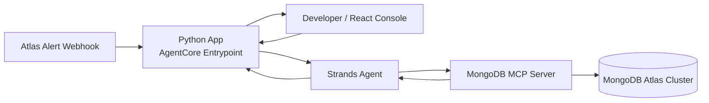

# Mongo Buddy

**A developer companion for MongoDB that turns MongoDB Atlas alerts into evidence-backed diagnostics.**

Mongo Buddy pairs a [Strands Agents](https://strandsagents.com/) agent with the official MongoDB MCP server. A React console renders the raw MCP responses (databases, slow-query explain plans, metrics, and root-cause evidence), so every conclusion can be traced to real data.

Built as a live demo for [AWS Community Day Mumbai](https://acd.awsugmum.in/).

---

## Problem Statement

Developers working with MongoDB often struggle to interpret Atlas alerts and system issues. A notice like “System Memory: Max Used above threshold” says that something went wrong, but not why it happened or what to do about it. Finding the cause means digging through metrics, slow-query logs and Performance Advisor, which takes time and deep database expertise. This slows down incident response and leaves teams reacting to alerts instead of fixing the underlying problem.

## Opportunity

Agentic AI can close this gap if it is grounded in real system state rather than generic advice. The Model Context Protocol (MCP) gives agents a standard, governed way to call tools against live infrastructure. The official MongoDB MCP server exposes database operations through that interface, so an agent can inspect actual deployments, run explain plans, and retrieve metrics instead of speculating.

## Solution

Mongo Buddy is organized into five layers:

| Layer | Component | Responsibility |
|---|---|---|
| **Reasoning** | Strands Agents SDK | Plans and sequences tool calls, then synthesizes results into findings |
| **Tool** | Official MongoDB MCP server | Discovers databases, runs slow-query explain plans, and pulls performance metrics from live clusters |
| **Experience** | React console | Displays the raw MCP responses so conclusions stay traceable and verifiable |
| **Runtime** | Amazon Bedrock AgentCore | Hosts the same Python app as a managed, scalable agent runtime |
| **Trigger** | Atlas alert webhook | Starts an investigation automatically when an alert fires |



## Key Design Principles

1. **Grounded in evidence:** Every recommendation is tied to real MCP output, not model assumptions.
2. **Standards-based:** MCP and open agent frameworks keep the stack modular and portable.
3. **Production-ready by design:** One codebase runs from a laptop to AgentCore, which shortens the path from demo to deployment.
4. **Human-in-the-loop transparency:** The console exposes the agent's inputs and outputs for review.

## Expected Outcomes

- Faster time from alert to root cause
- A lower expertise barrier for diagnosing query and index issues
- A reusable reference architecture for building production-grade AI agents on AWS with MongoDB

## Tech Stack

- **Agent framework:** [Strands Agents](https://strandsagents.com/)
- **Tooling protocol:** Model Context Protocol (MCP) with the official MongoDB MCP server
- **Runtime:** Python, Amazon Bedrock AgentCore
- **Frontend:** React
- **Data platform:** MongoDB Atlas

## Context

Mongo Buddy is a live demonstration for AWS Community Day Mumbai. It shows how agentic AI, MCP, and managed agent infrastructure combine into a practical, production-oriented developer workflow that goes beyond a conceptual demo.

## Run it locally

Requirements: Python 3.14, [uv](https://docs.astral.sh/uv/), Node.js, and AWS credentials that can call Amazon Bedrock in `ap-south-1`.

```bash
cp .env.example .env
# Fill in MDB_MCP_API_CLIENT_ID and MDB_MCP_API_CLIENT_SECRET.
# Add this laptop's public IP to that service account's Atlas API access list.
# Atlas returns 403 IP_ADDRESS_NOT_ON_ACCESS_LIST until the current address is listed.

chmod +x scripts/dev.sh
./scripts/dev.sh
```

Open http://127.0.0.1:5173. The agent listens on http://127.0.0.1:8080 (`POST /invocations`, `GET /ping`).

The MCP process is the official remote server, started as:

```bash
npx -y mongodb-atlas-mcp-remote@latest
```

Credentials are passed through `MDB_MCP_API_CLIENT_ID` and `MDB_MCP_API_CLIENT_SECRET`. A `MDB_MCP_CONNECTION_STRING` is optional if you would rather connect as a database user.

Try the chips in the ask panel: list databases, inspect `aws_summit.customers`, explain a city/age query, read storage metrics, or ask for a root cause.

## Deploy to AgentCore

The runtime entrypoint is `src/mongo_buddy/agentcore_app.py`. It exposes the required `POST /invocations` and `GET /ping` routes via `BedrockAgentCoreApp`. An async entrypoint streams tool calls and the answer as server-sent events.

Build the ARM64 image and push it to ECR in `ap-south-1`, then create a runtime. Set the same environment variables as `.env` on the runtime, including the Atlas service account, and allow the runtime's egress IP in the Atlas API access list.

```bash
docker build --platform linux/arm64 -t mongo-buddy .
# tag, push to ECR, then:
agentcore configure -e src/mongo_buddy/agentcore_app.py --name mongo_buddy --region ap-south-1
agentcore launch
```

The model id defaults to `in.anthropic.claude-opus-5` in `ap-south-1`. Override `MODEL_ID` if that inference profile is not enabled on the account. `apac.amazon.nova-pro-v1:0` is a working fallback.

## Atlas alert webhook

Atlas can POST an alert to the Lambda function URL. Lambda checks the `X-MMS-Signature` HMAC, ignores every event except `alert.open`, and invokes the AgentCore runtime that is already deployed. The agent receives `{"prompt": "..."}`, the same payload the developer UI sends, and investigates with the MongoDB MCP server.

The HTTP handler returns 202 as soon as the investigation is queued. A second invocation of the same function calls AgentCore, so a long diagnosis does not expire the Atlas webhook. The console shows "New alert detected" while that investigation runs, then the developer-facing analysis.

```bash
cd webhook
sam build
sam deploy --guided --parameter-overrides "WebhookSecret=$(openssl rand -base64 32)"
```

Use the printed URL and the same secret in Atlas: Project Settings → Integrations → Webhook Settings. Then add Webhook as a notification on the alerts that should wake Mongo Buddy. The inline policy in `webhook/iam-policy.json` is the same permission the template attaches: `bedrock-agentcore:InvokeAgentRuntime` on the Mongo Buddy runtime.

Keep the AgentCore runtime's MCP credentials read-only. The investigation prompt asks for diagnostics and recommendations, and it will not treat an alert as approval to change the cluster.

## Tests

```bash
uv run --with pytest pytest
```
